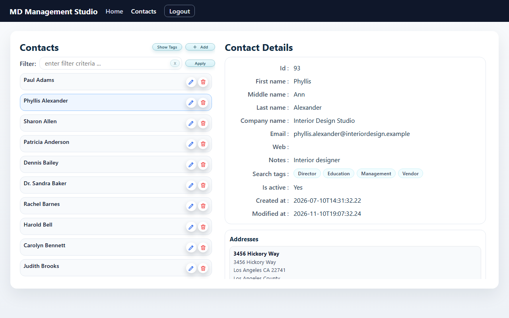
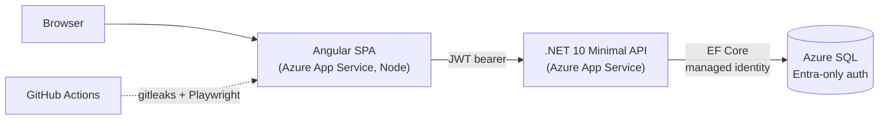

# MD Management Studio

A contact management app (.NET 10 API + Angular on Azure) that I rebuilt with AI-assisted development (Claude Code) and then hardened. The point was to show how I run AI in an engineering workflow with guardrails, not just a demo that works.

[](https://github.com/mldanello/md-management-studio/actions/workflows/build.yml)
[](https://github.com/mldanello/md-management-studio/actions/workflows/gitleaks.yml)
[](https://github.com/mldanello/md-management-studio/actions/workflows/e2e.yml)


**[Try the live demo →](https://mdmanagementstudio-ng-gui.azurewebsites.net)** Click **Demo** on the login page. No password, and no real data.



---

## What it does

- Sign in with one click (passwordless demo login) or with a username and password.
- Browse and filter contacts, then view a contact's details.
- Create, edit, and delete contacts, including their phone numbers and addresses.
- Tag contacts with search tags.
- See the running API and UI versions, so you always know which build is live.

## Architecture



| Layer | What's used |
|---|---|
| **API** | .NET 10, ASP.NET Core Minimal APIs (route groups per feature), EF Core 10 (SQL Server provider, retry on transient failures), JWT bearer auth, Swagger/OpenAPI, Serilog. Handlers use the DbContext directly today; moving data access behind repositories is on the roadmap. |
| **UI** | Angular 22 standalone components with signals, Angular Material, an HTTP interceptor that attaches the token, and a route guard that handles expired sessions |
| **Data** | Azure SQL. The API connects with its managed identity (`Authentication=Active Directory Default`), so there is no database password anywhere in config. |
| **Hosting** | Two Azure App Services: one for the API, one for the UI (a small Node server for the SPA that serves `/__version`). |
| **CI** | GitHub Actions: build and unit tests for the API and UI (warnings fail the build), a gitleaks secret scan on every push and PR, and Playwright E2E smoke tests on push, PR, and a daily schedule. |

### Repository layout

```
API/MDMSApi2/        .NET 10 API (Endpoints/, Domain/, Repositories/, Settings/)
API/MDMSApi2Tests/   xUnit tests (EF Core in-memory)
client/              Angular app
e2e/                 Playwright tests (run against the live demo by default)
Database/            SQL scripts for the schema and sample data
.github/workflows/   gitleaks and E2E pipelines
```

## Engineering decisions

**Secrets stay out of the repo.** No connection strings, keys, or passwords are committed. Production settings live in Azure App Service configuration, local settings in .NET user secrets, and `appsettings.Example.json` shows the shape. Options are bound and validated at startup (`ValidateOnStart`), so a missing JWT setting fails fast instead of at the first request.

**Entra-only Azure SQL.** SQL logins are turned off on the server. The API authenticates with its managed identity, which removes a whole class of leaked-password risk.

**Passwordless demo login.** The **Demo** button calls `POST /token/demo`, which issues a short-lived JWT for the demo user. The demo user gets a random password at seed time that is hashed and immediately discarded, so there is no shared demo password to leak or warn about. When `Demo:Enabled` is off, the endpoint returns 404 as if it did not exist.

**Secret scanning in CI.** gitleaks runs on every push and PR across the full history, with a custom rule for passwords inside SQL connection strings. The gitleaks binary is pinned by version and verified by SHA-256 before it runs.

**End-to-end tests against the real thing.** Playwright runs in Chromium and Firefox and covers the demo login, redirecting a logged-out visitor, the session-expired message, the contacts page, keyboard selection of a contact, and the API version check. A daily run catches a broken demo before anyone else does.

**Version endpoints.** `GET /version` on the API and `GET /__version` on the UI report the build that is running. The API version comes from the csproj and includes the git commit.

**Dependency hygiene.** Packages are kept current, and a vulnerable transitive package (`System.Security.Cryptography.Pkcs`) is pinned to a patched version, with a comment that says when the pin can be removed.

**Accessibility.** Contact names in the list are keyboard-focusable buttons, Edit and Delete have named labels, and the list uses proper roles. An E2E test covers keyboard selection.

### How I use AI

This project was rebuilt with AI-assisted development, under a simple rule:

> **AI suggests, a separate AI reviews, and I decide and merge.**

Every change goes through a pull request. I work with Claude Code in VS Code to write the change, a separate Claude session reviews the finished work against the plan, and I read both, decide, and merge. Guardrails like gitleaks and the E2E suite exist so that speed doesn't cost safety.

## Project history

- **v1 (about three years ago).** The first version, built by hand without AI, with a simpler UI.
- **v2.0.** Rebuilt with AI-assisted development: Claude Code for writing, and a separate Claude session for review. MVP first: a live demo with no real data, putting a working product ahead of polish.
- **v2.1 (this repo).** Hardening. I audited the git history, found more than I expected (old JWT signing keys, a database password in a dev config, and AI-generated deployment notes with real keys pasted in), and rotated or disabled every credential I found. I switched Azure SQL to Entra-only auth, replaced the demo password with a passwordless demo login, and added gitleaks and Playwright E2E to CI. Then I started this fresh public repo with clean history; the earlier history stays private.

## Run it locally

Requirements: .NET 10 SDK, Node 24, and a SQL Server database.

```bash
# API (see appsettings.Example.json for the settings it expects)
cd API/MDMSApi2
dotnet user-secrets set "Jwt:Key" "<a random key of at least 32 characters>"
dotnet user-secrets set "ConnectionStrings:DefaultConnection" "<your SQL Server connection string>"
dotnet run --launch-profile https      # https://localhost:7219, which the UI proxy expects

# UI (proxies /api to the local API)
cd client
npm ci
npm start            # http://localhost:4200

# E2E tests against your local UI
cd e2e
npm ci
npx playwright install chromium
E2E_BASE_URL=http://localhost:4200 npx playwright test --project=chromium
```

The schema and sample data scripts are in `Database/`. A Docker-based local SQL Server is on the roadmap.

## Roadmap

- [ ] Local SQL Server in Docker (docker compose) with schema and seed scripts, so development never touches the live database
- [ ] Move data access behind repositories so endpoint handlers stay thin and testable
- [ ] Unit tests and API integration tests (`WebApplicationFactory`)
- [ ] Playwright CRUD tests against a local or ephemeral environment
- [ ] A PR gate on an ephemeral environment
- [ ] CI/CD that deploys only when build, tests, and E2E are green, then runs a post-deploy smoke test
- [ ] Multi-tenancy (the `Tenant` table and `Contact.TenantId` exist; tenant isolation is not built yet)
- [ ] Activities (calls, meetings, and notes on a contact)
- [ ] AI relationship health: AI-generated insight on how each relationship is trending

## License

Copyright © 2026 Mark L. Danello. All rights reserved. This code is published for portfolio review. You may read it, but please don't reuse it without permission. See [LICENSE](LICENSE).
